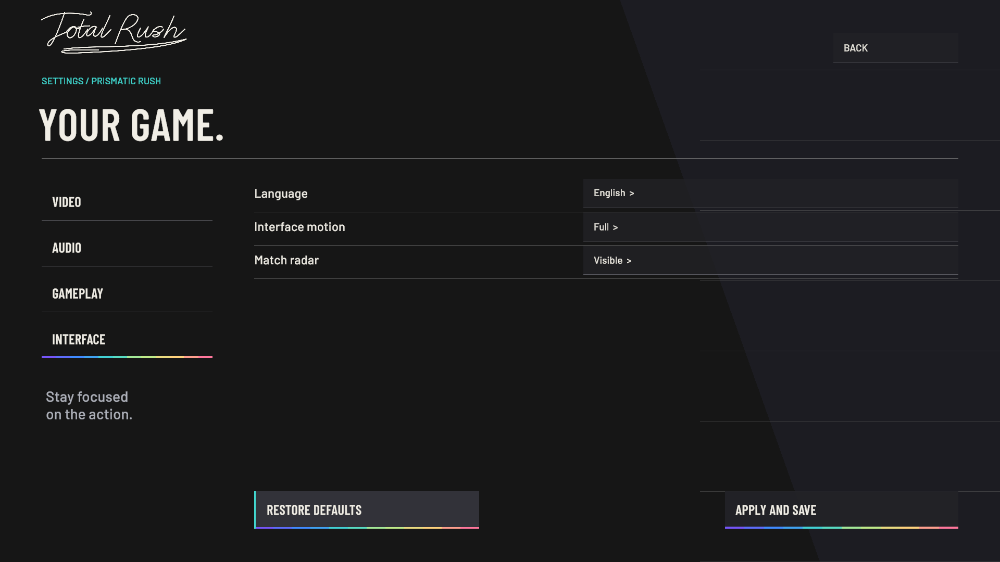
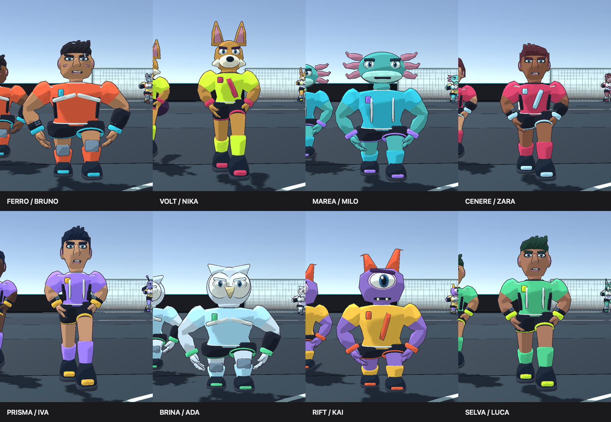
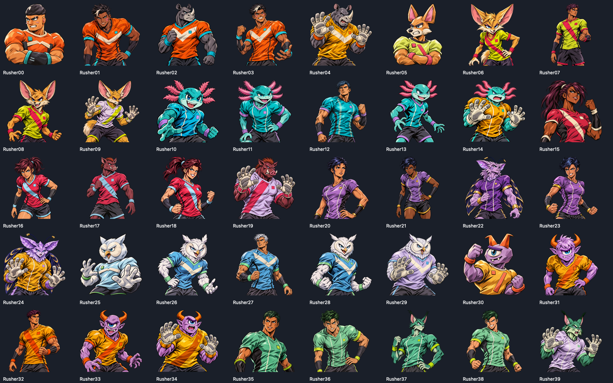

<strong>Arcade football. Original teams. Play loud.</strong>

macOS Apple Silicon · Windows x64 · Version 0.2.0

  <a href="https://github.com/YooTommy-CH/total-rush/releases/latest"><strong>DOWNLOAD TOTAL RUSH</strong></a>
  &nbsp; · &nbsp; <a href="INSTALLATION.md">Installation and updates</a>
  &nbsp; · &nbsp; <a href="CHANGELOG.md">What's new</a>

## Ink / Thunder — 0.2.0

Forty original human, animal and fantasy athletes, with distinctive proportions, faces, sportswear and inked portraits. Articulated hands, three detail levels per model and original team animation sets. Compact portraits sit next to player names; diagonal comic panels and branching lightning celebrate a perfect shot.

Kickoff requires a pass, including backward passes. When an AI teammate recovers the ball, control switches to them automatically. Improved dribbling, running loops, signature intro and a short goal sound. Substitutions have been removed.

**English is the default language**, including on the first launch. Italian remains available in **Settings → Interface → Language**. Apply and save to keep your preference.

## Enter the arena

Four rushers and one goalkeeper per side. Pass, sprint, tackle and use the walls to build an attack. Shoulder charges push opponents away; consecutive passes charge the ball's energy. Choose a three-, five- or seven-minute Rush Match.

Eight original teams, each with its own captain, colours and emblem: **Ferro, Volt, Marea, Cenere, Prisma, Brina, Rift and Selva**. The roster mixes humans with rhinoceroses, fennec foxes, axolotls, volcanic boars, crystalline moths, snowy owls, cyclopean creatures and lynxes. Each team has four outfield variants and a dedicated goalkeeper. No referees or coaches.

## Thunder Shot

1. Press and release the shoot button.
2. Tap it again quickly to open the curved timing meter. Gameplay slows to 0.80×.
3. Tap a third time to stop the cursor, which keeps moving in real time.

| Result | Goal chance |
| --- | ---: |
| Gray | 1% |
| Yellow | 30% |
| Orange | 60% |
| Red | 100% |

The red window occupies just 1.2% of the arc. Hit it for **PERFECT!**, an animated comic cut-in and a branching lightning trail. The perfect shot flies at a nominal 92 m/s, compared with 34 for other successful Thunder Shots, along a flatter trajectory. No confirmation resolves to gray. Failed attempts become ordinary short physical shots.

Thunder Shot and Rush Strike are separate: Rush Strike uses full ball energy and a charged power shot, and remains a physical, saveable strike.

## Ways to play

| Mode | What to expect |
| --- | --- |
| Rush Match | Choose two teams, your side and match length. |
| Rush Cup | Group stage followed by knockouts. |
| Iron Knockout | A straight knockout tournament. |
| The Circuit | A season with the eight original teams. |
| Training | Free training, practice matches, penalties and free kicks. |
| Player career | Create your rusher and develop your player. |

## Essential controls

| Action | Keyboard | Xbox | PlayStation |
| --- | --- | --- | --- |
| Move | WASD / arrow keys | Left stick | Left stick |
| Sprint | Shift | RT | R2 |
| Pass | J | A | Cross |
| Shoot | Hold and release K | Hold and release B | Hold and release Circle |
| Thunder Shot | K ×3 | B ×3 | Circle ×3 |
| Lob pass | L | X | Square |
| Shoulder charge | Space | Y | Triangle |
| Switch rusher | Tab | LB / right stick | L1 / right stick |
| Slide tackle | V | Press right stick | Press R3 |
| Pause | Esc | Menu | Options |

Finesse, power, low and trivela shots: see **Settings → Gameplay → Controls** for modifiers.

## Download and updates

Download **[Total Rush 0.2.0](https://github.com/YooTommy-CH/total-rush/releases/tag/v0.2.0)** for macOS Apple Silicon or Windows x64. The macOS app and custom DMG are Developer ID signed and Apple notarized. Drag **Total Rush** to **Applications** to install. The executable names are **Total Rush.app** and **Total Rush.exe**.

If upgrading from 0.1.0, install the current version manually once because the package names changed. Versions from 0.1.1 onward check for updates on launch. **Update now** downloads and verifies the package, closes the game, installs the update and reopens it. Your local saves and music library are preserved.

## Your Rush Radio

No soundtrack is bundled. On the **Soundtrack** page, select your MP3 folder and artwork folder separately. They can be anywhere on your device.

Artwork names must match tracks exactly, excluding the extension: `Title - Artist.mp3` → `Title - Artist.png`. If they differ, select **Artwork** beside the track and assign an image manually. Manual assignments are saved. Tracks without artwork still play with a generic image.

Playback works offline with crossfades between tracks. **Rescan** refreshes the library; disconnecting leaves your files intact. Personal music, artwork and the game's source code are not distributed in this repository.

## Release verification

A playable game in active development, built with Unity 6.6 and URP. Screenshots show the actual English build. Teams, characters, emblems and visual identity are original; no Nintendo characters or assets are included.

The macOS build has been run and checked. The Windows x64 player is also launched and tested on Windows Server 2022 without rendering; graphics and physical controllers on Windows 10/11 still need PC testing. The 60 FPS target on baseline M1 hardware remains unmeasured. Online and local multiplayer are outside this version.

See [CREDITS.md](CREDITS.md) for resources and licences.
