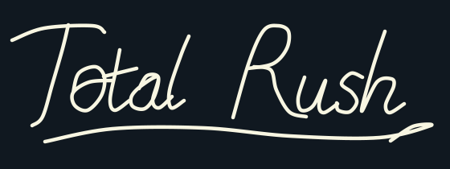
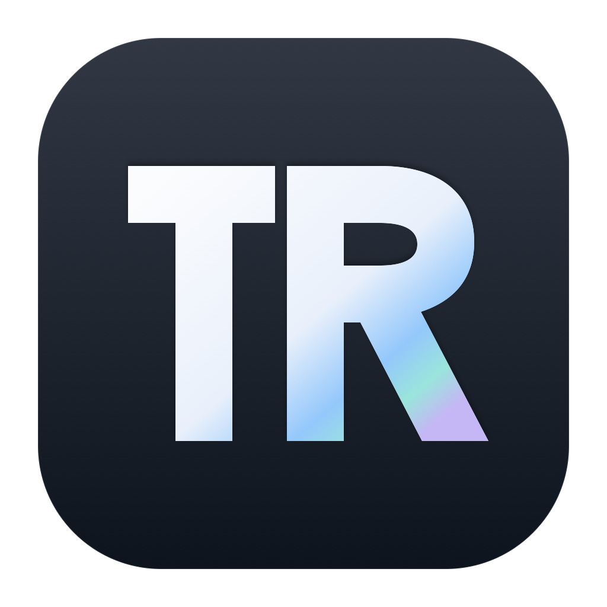
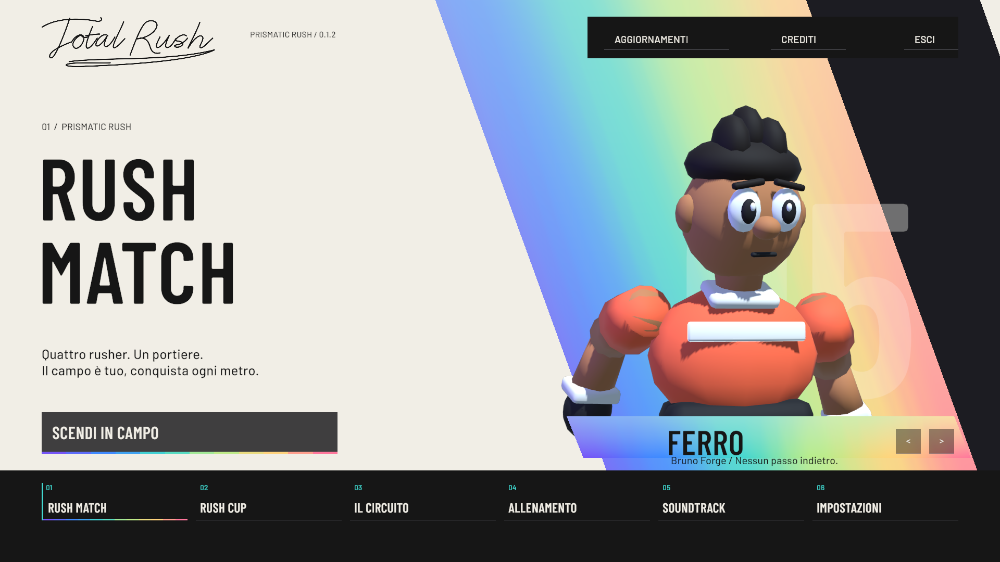
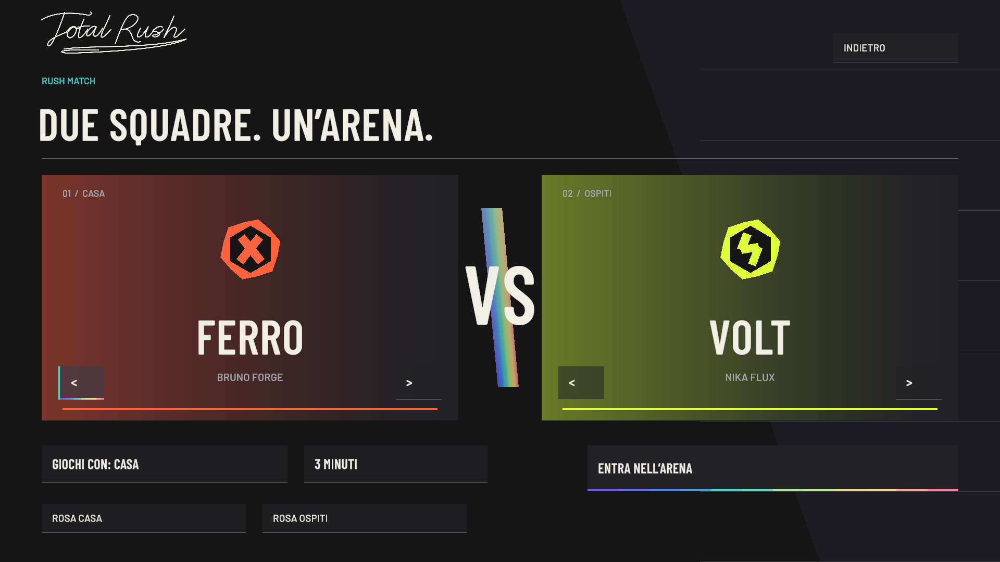
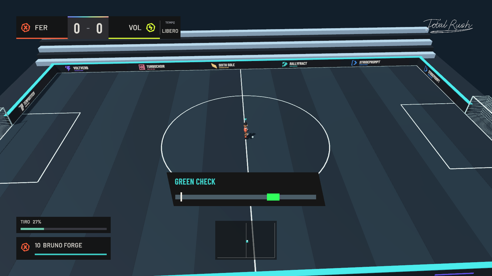
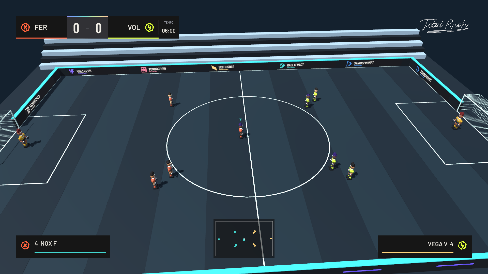

<p align="center">
  
</p>

<p align="center"></p>

<p align="center"><strong>Calcio arcade. Squadre originali. Nessun freno.</strong></p>
<p align="center">macOS Apple Silicon · Windows x64 · Versione 0.1.2</p>

<p align="center">
  <a href="https://github.com/YooTommy-CH/total-rush/releases/latest"><strong>SCARICA TOTAL RUSH</strong></a>
  &nbsp; · &nbsp;
  <a href="INSTALLAZIONE.md">Installazione e aggiornamenti</a>
  &nbsp; · &nbsp;
  <a href="CHANGELOG.md">Novità</a>
</p>



## Prismatic Rush — 0.1.2

Una nuova identità visiva: carta chiara, antracite e luce prismatica. Menu con capitano 3D integrato, selezione delle squadre contrapposte, impostazioni ridisegnate e transizioni direzionali. Il nuovo tabellone mantiene punteggio e timer in colonne stabili; energia, potenza, radar e risultati condividono la stessa geometria. Otto sponsor immaginari originali animano i cartelloni dell’arena.



## Entra nell’arena

Quattro rusher e un portiere per squadra. Passa, scatta, colpisci e usa le sponde per costruire l’azione. Le spallate spostano gli avversari; i passaggi consecutivi caricano il pallone. In Rush Match scegli tre, cinque o sette minuti.

Otto squadre originali, ognuna con capitano, colori e simbolo propri: **Ferro, Volt, Marea, Cenere, Prisma, Brina, Rift e Selva**. Dodici modelli cartooneschi creati in Blender, con rig animato e tre livelli di dettaglio. Arbitri e allenatori assenti.

## Green-Check

**Un tiro. Tre tocchi. Un momento da prendere.**

1. Premi e rilascia il tasto del tiro.
2. Premilo di nuovo rapidamente per aprire lo skill check: l’arena va in slow motion.
3. Premi la terza volta quando il cursore attraversa il verde.

Il cursore resta in tempo reale. Il tempismo perfetto scatena un tiro elettrico e infuocato che segna da qualsiasi posizione; sbagliando, parte un tiro senza bonus. È una meccanica arcade, distinta dai tiri normali.



## Modi di giocare

| Modalità | Cosa trovi |
| --- | --- |
| **Rush Match** | Scegli le due squadre, il lato e la durata. |
| **Rush Cup** | Gironi e fase a eliminazione. |
| **Iron Knockout** | Conquista il torneo a eliminazione diretta. |
| **Il Circuito** | Una stagione fra le otto squadre originali. |
| **Allenamento** | Campo libero, partitella, rigori e punizioni. |



## Comandi essenziali

| Azione | Tastiera | Xbox | PlayStation |
| --- | --- | --- | --- |
| Muoviti | WASD / frecce | Stick sinistro | Stick sinistro |
| Sprint | Shift | RT | R2 |
| Passa | J | A | Croce |
| Tira | Tieni e rilascia K | Tieni e rilascia B | Tieni e rilascia Cerchio |
| Green-Check | K ×3, terzo sul verde | B ×3, terzo sul verde | Cerchio ×3, terzo sul verde |
| Passaggio alto | L | X | Quadrato |
| Spallata | Spazio | Y | Triangolo |
| Cambia rusher | Tab | LB / stick destro | L1 / stick destro |
| Scivolata | V | Premi stick destro | Premi R3 |
| Pausa | Esc | Menu | Options |

Tiri a giro, potenti, rasoterra e trivela: modificatori nella schermata **Impostazioni → Gioco → Comandi**.

## Download e aggiornamenti

Scarica **[Total Rush 0.1.2](https://github.com/YooTommy-CH/total-rush/releases/tag/v0.1.2)** per macOS Apple Silicon o Windows x64. La build macOS è firmata con Developer ID e notarizzata da Apple. Su Mac è disponibile anche un **DMG personalizzato**, con installazione trascinando l’app in Applicazioni. App ed eseguibile si chiamano ora **Total Rush.app** e **Total Rush.exe**.

**Passaggio dalla 0.1.0:** scarica e installa manualmente questa versione una volta, perché sono cambiati i nomi dei pacchetti. Dalla 0.1.1 il gioco controlla gli aggiornamenti all’apertura: **Aggiorna ora** scarica e verifica il pacchetto, chiude l’app, installa e riapre il gioco. La libreria personale e i salvataggi restano nel profilo del dispositivo. La soundtrack personale, le copertine e il codice sorgente non sono distribuiti in questo repository.

## La tua Rush Radio

Nessuna soundtrack inclusa. Seleziona **Soundtrack → Scegli cartella** e collega la tua raccolta:

```
Total Rush Soundtrack/
    Canzoni/Brano - Artista.mp3
    Copertine/Artista - Brano.png
```

Abbinamento anche per ordine delle parole, maiuscole, accenti e piccole differenze. Le corrispondenze ambigue mantengono la copertina generica. MP3 senza copertina restano riproducibili. I file rimangono sul dispositivo, funzionano offline e usano la dissolvenza fra brani. **Rileggi** aggiorna l’elenco; **Scollega** conserva i tuoi file.

## Stato della versione

Anteprima giocabile in sviluppo, realizzata con Unity 6.6 e URP. Le immagini sono catture della build del gioco, senza sfondi generati. Squadre, personaggi, simboli e identità sono originali; nessun personaggio o asset Nintendo incluso.

La build macOS è stata eseguita e verificata. La build Windows è compilata e richiede ancora prove su hardware Windows. Il risultato di 60 FPS su M1 di base resta da misurare. Online e multiplayer locale non sono inclusi nella 0.1.2.

Attribuzioni e licenze di animazioni, font e dipendenze sono incluse nell’app. Vedi [CREDITI.md](CREDITI.md).
